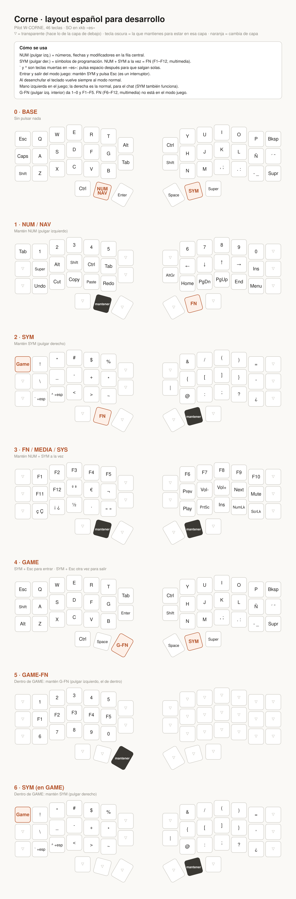
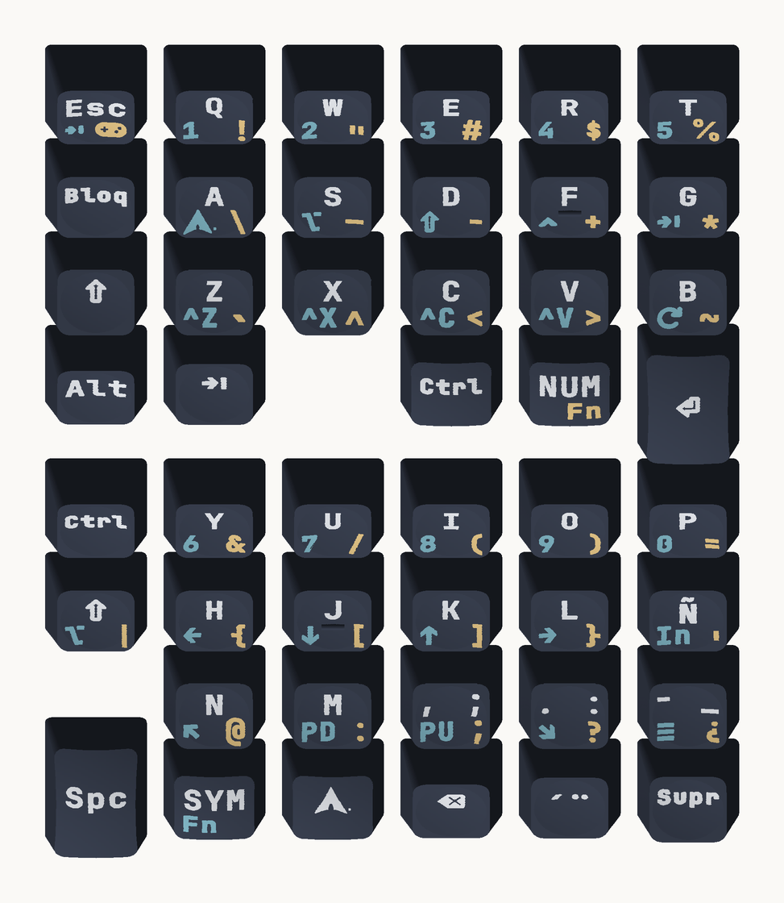

# Corne en español para programar

Layout para un **Corne de 46 teclas con firmware Vial**, pensado para escribir en castellano
y programar con el sistema operativo en **distribución de teclado española** (`es`).
Incluye un **modo juego**, **tarjetas recortables** con todas las capas para tener a la vista
y **keycaps imprimibles en 3D** a 4 colores con las leyendas de cada capa.

Probado en un **Pilot W-CORNE** (Corne v4.1 de 46 teclas: 3×6 por mano, una columna interior
de 2 teclas a cada lado y 3 pulgares por mano, el más interior de 1,5u).



## Qué hay aquí

| | |
|---|---|
| [`corne_es_dev.vil`](corne_es_dev.vil) | el layout, listo para cargar en Vial |
| [`docs/corne-es-layout.pdf`](docs/corne-es-layout.pdf) | tarjetas A4 recortables, una por capa, para pegar en la pared |
| [`docs/aprender.md`](docs/aprender.md) | cómo acostumbrarse al teclado: plan por fases y ejercicios |
| [`docs/diseno.md`](docs/diseno.md) | el porqué de cada decisión, con la tabla de `es` verificada |
| [`keycaps/`](keycaps/) | generador de keycaps MX imprimibles a 4 colores |
| [Releases](https://github.com/CFerndp/corne-es-layout/releases) | **los STL listos para imprimir**, sin necesidad de generarlos |

## Cargar el layout

1. Abre Vial: la [versión web](https://vial.rocks) (Chrome, Chromium, Brave…; no funciona en
   Firefox) o la [aplicación de escritorio](https://get.vial.today).
2. Conecta el teclado y ve a **File → Load saved layout** → `corne_es_dev.vil`.
3. Los cambios se escriben en el teclado al momento, sin reflashear. El layout se queda
   guardado en el propio teclado: funciona en cualquier ordenador sin instalar nada.

**En Linux**, si Vial ve el teclado pero se queda en *Connecting to the device…*, falta
permiso para abrir el dispositivo. La [guía de Linux de Vial](https://get.vial.today/manual/linux-udev.html)
explica cómo añadir la regla `udev`. Basta con hacerlo una vez.

## Las capas

Las capas se activan **manteniendo** una tecla de pulgar, salvo el modo juego, que funciona
como un interruptor.

| Capa | Cómo se llega | Qué tiene |
|---|---|---|
| 0 · BASE | — | QWERTY con `Ñ`, `´ ¨`, `- _`, `, ;`, `. :` en su sitio |
| 1 · NUM/NAV | mantener **NUM** (pulgar izquierdo) | números, flechas en `H J K L`, Inicio/AvPág/RePág/Fin, modificadores en `A S D F`, deshacer/cortar/copiar/pegar/rehacer, AltGr |
| 2 · SYM | mantener **SYM** (pulgar derecho) | todos los símbolos de programación |
| 3 · FN | mantener **NUM y SYM** a la vez | F1–F12, multimedia, `º ª`, `€`, `ç Ç`, `¡ ¿`, `« »` |
| 4 · GAME | **SYM + Esc** para entrar y salir | modo juego (abajo) |
| 5 · GAME-FN | dentro de GAME, mantener **G-FN** | números 1–0 y F1–F5 en la mano izquierda |
| 6 · SYM | dentro de GAME, mantener **SYM** | los símbolos, para escribir en el chat |

### Castellano

- `´` y `¨` son teclas muertas, como en un teclado español: `´` + `a` → á, `¨` + `u` → ü.
- `` ` `` y `^` también son muertas en `es`: hay que **pulsar espacio después** para que
  salgan solas. En la capa SYM aparecen como `` ` +esp`` y `^ +esp`.
- Bloq Mayús se ha dejado en su sitio. En muchas configuraciones de Linux hace también de
  tecla **Compose** (sola o con Shift, según la distribución), para escribir `— → © °`.

### Modo juego

Pensado para juegos con la mano izquierda en el teclado y la derecha en el ratón.
**SYM + Esc** activa y desactiva el modo, como un interruptor. Al desenchufar el teclado
vuelve siempre al modo normal.

```
 Esc    Q  W  E  R  T  [Tab  ]      ← columna interior: teclas que se pulsan sueltas
 Shift  A  S  D  F  G  [Enter]
 Alt    Z  X  C  V  B
          Ctrl  Space  G-FN         ← pulgares
```

- Los modificadores (Shift, Alt, Ctrl) quedan en el meñique y el pulgar, en reposo.
- La mano derecha no cambia, así que el chat funciona como siempre.
- La capa FN (F6–F12 y multimedia) no está disponible dentro del modo juego.

## Llevarlo a otro ordenador

El layout va dentro del teclado, pero depende de la **distribución de teclado del sistema**:
el firmware envía posiciones de un teclado estadounidense y es el sistema el que las
traduce con la distribución española.

| Sistema | Resultado |
|---|---|
| Linux en español | todo igual |
| Windows o macOS en español | letras, `ñ`, acentos, números y casi todos los símbolos, bien |
| Cualquier sistema en inglés (US) | las letras bien; `ñ`, acentos y símbolos salen mal |

En Windows o macOS en español hay tres diferencias: `~` es tecla muerta en Windows (espacio
después), `½ ¬ « »` no existen fuera de Linux, y en macOS AltGr es Option y algún símbolo
cambia de sitio. Los corchetes `{ [ ] }` y `| @ # \ €` funcionan en los tres sistemas porque
usan las mismas combinaciones que vienen serigrafiadas en un teclado español.

## Keycaps impresos

[`keycaps/`](keycaps/) genera las 46 teclas para switches MX a 4 colores (cuerpo, letra,
capa NUM y capa SYM). Probadas en una Anycubic Kobra S1 con ACE Pro y boquilla de 0,4.



- **Perfil esculpido**: cada fila a su altura e inclinación, superficie cóncava, cúpula en
  los pulgares y barra de posición en F y J.
- **Leyendas incrustadas a ras**: no se desgastan y no se notan al tacto. Su forma está
  calculada para que el slicer no descarte trazos finos.
- **Variante plana** (`--flat`): mucho más rápida de imprimir.

**Los STL ya generados** (placa esculpida, placa plana, tecla de prueba y probeta) están
en la página de [Releases](https://github.com/CFerndp/corne-es-layout/releases): no hace
falta instalar nada para imprimirlas. Detalles, cómo generarlas y cómo imprimirlas:
[`keycaps/README.md`](keycaps/README.md).

## Modificar el layout

Todo sale de [`spec.py`](spec.py), que describe las capas tecla a tecla. Después de
editarlo:

```bash
python3 build_vil.py        # spec.py → corne_es_dev.vil
python3 render_diagram.py   # spec.py → docs/corne-es-layout.{svg,png,pdf}
```

- **Requisitos**: Python 3.10 o posterior, sin dependencias. Para el PNG y el PDF hace falta
  además `rsvg-convert` (paquete `librsvg`).
- `build_vil.py` no reconstruye el `.vil`: parte del original del fabricante
  ([`baseline/`](baseline/)), sustituye solo las capas y comprueba que no se ha tocado
  nada más (combos, tap-dance, ajustes) ni se ha puesto una tecla donde no la hay.

```
spec.py              las capas: la fuente de todo lo demás
build_vil.py         genera corne_es_dev.vil
render_diagram.py    genera el diagrama y las tarjetas
baseline/            el .vil original del fabricante, sin tocar
docs/                diagrama, tarjetas, diseño y guía de aprendizaje
keycaps/             generador de keycaps imprimibles
```

## Ideas para más adelante

- Macro para `` ` `` y `^` en una sola pulsación.
- Combos (Vial tiene 32 libres): por ejemplo `J` + `K` → Esc.
- *Home row mods*, si compensa el tiempo de adaptación.

## Licencia

[MIT](LICENSE): puedes usarlo, modificarlo y redistribuirlo libremente manteniendo el aviso
de copyright.
