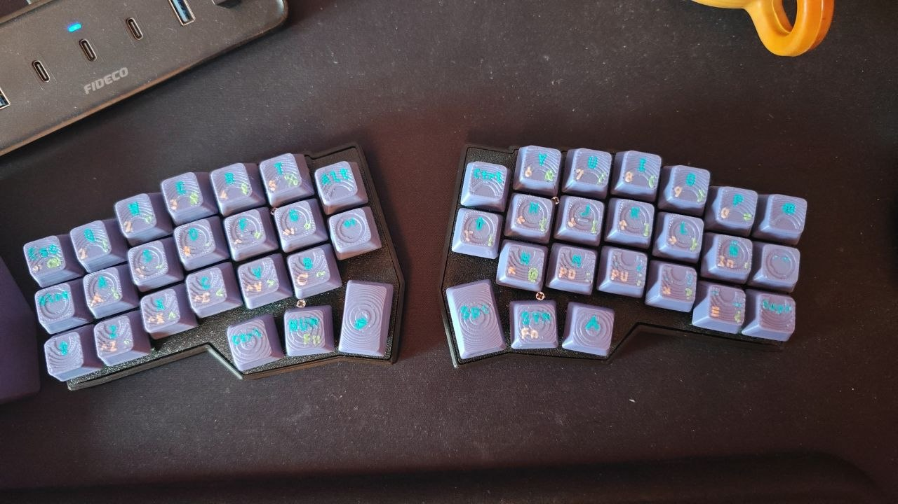
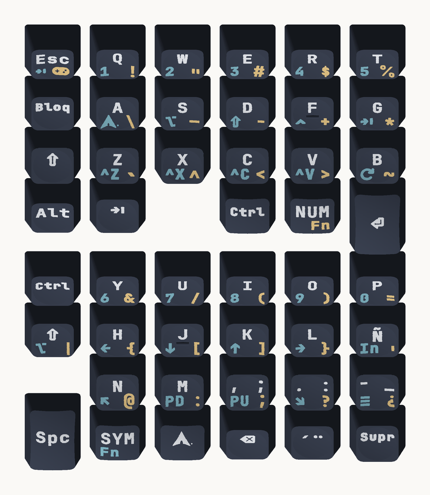

# Keycaps imprimibles para el Corne

Generador paramétrico de las 46 teclas del layout, para **switches MX**, impresas en FDM a
**4 colores**. Las leyendas salen de [`../spec.py`](../spec.py): si cambias el layout,
cambian las teclas.

Probado imprimiendo la **placa esculpida completa** en una **Anycubic Kobra S1 con ACE Pro
y boquilla de 0,4**: las 46 teclas encajan en los switches y las leyendas salen limpias.



**Para imprimirlas no hace falta generarlas:** los STL están en la página de
[Releases](https://github.com/CFerndp/corne-es-layout/releases) del repositorio.



## Qué lleva cada tecla

```
┌──────────────┐
│      F       │  letra principal (capa BASE), centrada
│      ▬       │  barra de posición (solo F y J)
│ ⌃          + │  capa NUM abajo a la izquierda · capa SYM abajo a la derecha
└──────────────┘
```

| Filamento | Parte |
|---|---|
| 1 | cuerpo de la tecla |
| 2 | leyenda principal (capa BASE) |
| 3 | leyenda de la capa NUM |
| 4 | leyenda de la capa SYM |

- Las leyendas van **incrustadas a ras** (1 mm de profundidad): no se desgastan y no se
  notan al tacto.
- Las capas FN y de juego no se imprimen (harían falta más colores). Esc lleva un icono de
  mando como recordatorio de que SYM + Esc entra en el modo juego.
- Algunas leyendas se abrevian para que quepan con trazos imprimibles: Bloq Mayús → `Bloq`,
  Espacio → `Spc`, AltGr → `⌥`, Ins → `In`, RePág/AvPág → `PU`/`PD`, Rehacer → `↻`.

## Forma

| | Fila de arriba | Fila central | Fila de abajo | Pulgares |
|---|---|---|---|---|
| Altura en el centro | 9,4 mm | 8,4 mm | 8,9 mm | 8,4 mm + 0,8 de cúpula |
| Inclinación del tope | 8° hacia ti | plano | 6° hacia fuera | plano |
| Tope | cóncavo (esfera R40, 0,5 mm) | ídem | ídem | **convexo**: el pulgar pulsa de lado |

- Perfil esculpido: las filas forman una curva bajo los dedos, con la fila central como la
  más baja.
- Las teclas de la columna interior y de la columna exterior derecha llevan el perfil de la
  fila física en la que están.
- Enter y Espacio (el pulgar más interior) son de **1,5u**, alargadas hacia ti.
- **Encaje MX**: cilindro de 5,5 mm con cruz de 4,0 × 1,5 mm y 4 mm de profundidad. Se midió
  en un keycap impreso en la misma impresora que ya encajaba bien.

### Variante plana (`--flat`)

Las 46 teclas con el tope **plano, horizontal y a la misma altura** (8,36 mm), y las
leyendas incrustadas solo 0,36 mm. Con capas de 0,12 y primera capa de 0,2, las leyendas
caen exactamente en las **3 últimas capas** de todas las teclas.

En una impresión multicolor, lo que más tiempo cuesta son los cambios de color, y se hacen
en cada capa que tiene leyendas:

| Placa de 46 teclas | Capas con leyenda | Cambios de color (aprox.) |
|---|---|---|
| Esculpida | 27 | ~100 |
| Plana | 3 | ~12 |

A cambio se pierde la forma esculpida. **La variante plana no se ha impreso todavía.**

## Leyendas que se imprimen bien

Con boquilla de 0,4, el slicer (generador de perímetros clásico) **descarta los trazos de
menos de ~0,55 mm**, y los de menos de ~0,8 mm salen en borrón. Escribir el texto
directamente con la fuente daba trazos de 0,4–0,6 mm a tamaño de subleyenda.

[`glyphs.py`](glyphs.py) saca los contornos de la fuente y los prepara para FDM:

- engorda cada trazo hacia **0,9 mm** (2 líneas de extrusión de 0,42);
- rellena los huecos interiores de menos de 0,4 mm, que saldrían en borrón;
- separa las piezas sueltas (el punto de la `!`, las rayas del `=`) para que no se peguen;
- deja 0,35 mm de espacio extra entre letras.

`build_caps.py` **se niega a generar** si alguna leyenda incumple las reglas, y
[`check_stl.py`](check_stl.py) vuelve a medirlas en los STL ya generados.

## Generarlas

Requisitos:

- [uv](https://docs.astral.sh/uv/): instala solo las dependencias de Python (fontTools,
  shapely, numpy, pillow).
- **SolidCraft** (`solidcraft-cli`), el programa CAD que construye cada tecla (probado con
  la 0.30.1).
- La fuente **JetBrainsMono Nerd Font Bold** ([nerdfonts.com](https://www.nerdfonts.com)).
  Si no está en `/usr/share/fonts/TTF/`, indica su ruta con la variable `KEYCAP_FONT`.

```bash
uv run keycaps/build_caps.py --check        # comprueba las leyendas (segundos, sin CAD)
uv run keycaps/build_caps.py                # las 46 teclas + la placa (~17 min con -j 10)
uv run keycaps/build_caps.py --keys r1c4    # solo algunas teclas (rNcM = fila/columna de spec.py)
uv run keycaps/build_caps.py --flat         # variante plana → keycaps/out_flat/
uv run keycaps/build_caps.py --probe        # probeta de holgura del encaje
uv run keycaps/check_stl.py                 # mide las leyendas en los STL (--flat para la plana)
uv run keycaps/render_preview.py            # plate_preview.png (--flat para la plana)
```

Todo lo generado va a `keycaps/out/` (o `out_flat/`), fuera de git:

| Fichero | Para qué |
|---|---|
| `plate_corne.{cap,base,num,sym}.stl` | **la placa entera**, un STL por color |
| `plate_corne.3mf` | lo mismo en un solo fichero (1 objeto con 4 partes) |
| `stl/<tecla>.<color>.stl` | cada tecla suelta, para reimprimir una |
| `plate_probe.cap.stl` | la probeta |
| `sc/<tecla>.sc` | el diseño de SolidCraft de cada tecla |

Cómo funciona por dentro: `spec.py` → [`legends.py`](legends.py) (etiquetas cortas) →
`glyphs.py` (contornos imprimibles) → [`build_caps.py`](build_caps.py) (un script de
SolidCraft por tecla, ejecutado sin ventana) → [`mesh3mf.py`](mesh3mf.py) (agrupa por
color, repara micro-agujeros de la malla, comprueba que es estanca y escribe 3MF/STL).

## Imprimirlas

Se imprimieron con el **perfil de serie** de Anycubic Slicer Next para la Kobra S1
(«0.20mm Standard», boquilla de 0,4), sin cambiar nada. Importa los 4 STL de una tecla o de
la placa **a la vez, como un solo objeto con varias partes**, y asigna a cada parte su
filamento (`cap` = 1, `base` = 2, `num` = 3, `sym` = 4).

1. **Imprime antes una tecla suelta** (por ejemplo la F) y pruébala en un switch: debe
   entrar con presión firme y no bailar.
2. Si no encaja bien, imprime la **probeta**: 4 teclas sin leyenda con distinta holgura,
   marcadas con 1 a 4 muescas en el borde trasero (−0,05 / ±0 / +0,05 / +0,10 mm). Pon el
   valor de la que encaje en `STEM_CLEAR` y regenera.
3. Imprime la placa: los 4 STL `plate_corne.*.stl`.

Lo que más alarga una impresión multicolor son los cambios de color, que se hacen en cada
capa con leyendas. Por eso conviene **no usar altura de capa variable** (añade capas justo
donde están las leyendas) e **imprimir las teclas de prueba de una en una**: teclas de filas
distintas no comparten capas y los cambios se suman.

Material: PETG o PLA+ (el PLA normal se ablanda con el calor de la mano).

## Problemas conocidos de SolidCraft y cómo se esquivan

- Extruir texto crea un cuerpo por glifo y los booleanos los vuelven a partir: cada leyenda
  se une a una placa auxiliar y luego se agrupan por nombre.
- Restar cuerpos con caras coincidentes falla: la leyenda sobresale al restarla y se recorta
  contra la superficie después.
- En los pulgares (cúpula), restar la leyenda después de vaciar la tecla falla a veces: en
  ellos el hueco interior se hace al final.
- Con el glifo `␣`, la tecla de 1,5u sale con caras internas: por eso Espacio lleva `Spc`.
- La teselación deja agujeros de 1–2 triángulos donde la leyenda corta la superficie:
  `mesh3mf.py` los cierra. Si queda alguna grieta mínima sale como aviso; el slicer la
  repara al importar.
